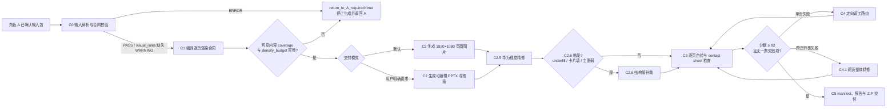

# huawei_ppt_builder / Role C

`huawei-ppt-builder` 是华为风格 PPT 生成流程中的角色 C。它读取角色 A 已确认的 `deck_spec.json`、页面设计和最小依赖包，将页面语义合同编译为可施工的逐页渲染合同，生成页面图片或用户明确要求的可编辑 PPTX，并完成视觉精修、自检、定向返工和交付打包。

角色 C 负责施工，不重新设计内容或补充事实。当前版本见 [`VERSION.md`](VERSION.md)，完整版本记录见 [`CHANGELOG.md`](CHANGELOG.md)。

## 核心原则

- `deck_spec.json` 是唯一事实源；渲染合同只是施工编译结果，不产生新的业务事实。
- 每页只服务一个 `core_judgement`，主图必须证明 `chart_proof_goal`。
- `layout_pattern` 决定页面怎么排，`chart_type` 决定图表如何证明；两者不得混用。
- `chart_semantic_mapping` 是复杂图表的最高语义约束，对应关系和边角色不得丢失。
- `logic-only` 字段及其值不得原文上屏，页面可见文字只能来自允许显示的字段。
- 优先使用确定性渲染保证中文、箭头、层级、页码和关系准确；生成式图片只用于非文本视觉素材。
- 默认交付页面图片；只有用户明确要求可编辑文件时才启用 PPTX 模式。
- C2 初版不得直接交付，必须经过 C2.5 华为视觉精修和 C3 自检；C2.6、C4、C4.1 只在触发条件命中时执行。
- 所有页面必须达到 92 分且无一票失败项，才能进入交付包。
- 输入合同缺失、冲突或无法在不删减证据的情况下实现时，必须 fail-closed 并返回角色 A。

## 推荐调用方式

默认页面图片模式：

```text
请启用 huawei-ppt-builder，读取角色 A 已确认的输入包，生成华为风格 PPT 页面图片。
要求：
1. 执行 C0-C5 完整流程；
2. 每页必须输出 1920×1080 PNG；
3. 保持 deck_spec 事实与图表语义不变；
4. 强制执行 C2.5 视觉精修；
5. 输出 contact sheet、自检报告、精修报告、delivery manifest 和 ZIP。
```

可编辑 PPTX 模式：

```text
请启用 huawei-ppt-builder，基于已确认输入包生成可编辑 PPTX。
标题、正文、卡片、图表和页脚应尽量保持可编辑，同时输出 PDF 或 PNG 预览、自检报告和可编辑性说明。
```

如果只需要优化已有页面图片，应同时提供原页面、自检报告、精修报告和原始语义输入，并明确要求执行定向返工流程。

## 全链路



关键约束：

- 除 `visual_rules.md` 外，必要输入缺失或校验失败必须阻断 C1/C2。
- 缺少 `visual_rules.md` 时只允许使用最小华为视觉 fallback，并在报告中记录 WARNING。
- 页面级显式 override 高于角色 C 内置默认值；不得用统一模板覆盖角色 A 的逐页设计意图。
- 任何精修或返工都不得改写页面语义合同、事实、`core_judgement` 或证明目标；上屏文案、`chart_type`、`layout_pattern` 只有在 C1.5 有效渲染方案中通过审计后才可变化。

## 输入合同

### 必要输入与规范输入

推荐输入目录：

```text
input_dir/
├── deck_spec.json                    # 唯一事实源和页面语义合同
├── page_design.md                    # 页面区域、版式动作和页型门禁
├── chart_patterns.md                 # chart_type 枚举与证明边界
├── layout_library.md                 # layout_pattern 枚举与组织语义
├── deck_spec_field_dictionary.md     # 字段职责与可见性边界
├── visual_rules.md                   # 角色 A 视觉规则 SSOT；缺失时仅允许 fallback
└── terminology_dictionary.md         # 可选；区域、页型和字段术语统一口径
```

校验脚本将前五项视为必要文件，`visual_rules.md` 为规范输入。只有 `visual_rules.md` 缺失时允许继续；其余必要文件缺失、JSON/schema 错误、页码错误、枚举非法或复杂关系字段非法都必须阻断生成。

### 输入优先级

发生冲突时按以下顺序裁决：

1. `deck_spec.json`；
2. `deck_spec_field_dictionary.md`；
3. `terminology_dictionary.md`；
4. `page_design.md`；
5. `chart_patterns.md`；
6. `layout_library.md`；
7. `visual_rules.md`；
8. 用户本轮提示词，仅作为执行门禁，不覆盖已确认合同。

## 核心能力

### C0 输入解析与 fail-closed

输入校验覆盖文件完整性、JSON 解析、页码连续性和唯一性、必要字段、`chart_type`、`layout_pattern`、`type` 枚举以及复杂图表语义字段。任一 ERROR 都必须停止后续生成并记录：

```text
return_to_A_required=true
```

同时输出错误字段、允许枚举和修复建议，避免角色 C自行猜测或改写语义合同。

### C1 渲染合同编译

逐页 `page_render_contract` 合并 `deck_spec.json`、`page_design.md`、`global_design_defaults` 和页面级 overrides，至少保留：

- 页面 ID、章节、标题、结论和可见文字计划；
- `type` 与 `type_source`；页型映射顺序为 A 的 `type` → 历史 `page_type` → `chart_type` 保守推断；
- `layout_pattern`、`chart_type`、`chart_proof_goal`；
- `chart_visual_boundary` 与 `forbidden_visualization`；
- `correspondence_pairs`、`edge_roles` 和其他复杂关系语义；
- 红色锚点、右侧洞察栏、页脚、视觉降噪约束和失败条件；
- `visual_notes`、`visual_focus`、`must_highlight`、`need_compression` 和 `data_gaps`；
- 结构化可见内容 coverage、`density_budget` 和 `required_evidence`。

渲染合同是内部施工层，不替代 A 的事实源，也不扩展为像素级绘图 DSL。

### C2 页面图片与 PPTX

默认 `page_images` 模式输出每页必须 1920×1080、16:9 PNG。适合页面效果图、评审稿、视觉稿和汇报预览。

用户明确要求“可编辑 PPTX”或“正式 PPTX”时启用 `pptx` 模式：

- 标题、正文、卡片、图表和页脚尽量使用可编辑对象；
- 复杂图形可使用组合形状；
- 高复杂装饰可使用图片层，但不得承载主要文字；
- 不得仅把整页 PNG 贴入 PPTX；
- 同步输出 PDF 或 PNG 预览、自检报告和可编辑性说明。

### C2.5 视觉精修与密度保真

C2.5 是强制阶段。规则优先级为输入包 `visual_rules.md` → 页面级 overrides → 最小 fallback。允许调整对齐、留白、间距、字号、换行、局部层级、颜色强弱、边框、线条、节点位置和连线，但不允许改动语义或删除证据。

精修必须：

- 压稳标题区、网格、卡片、边框、内边距和箭头；
- 把唯一主红色锚点绑定到核心判断或关键节点；
- 强化主图证明路径，控制右侧洞察栏和底部结论条；
- 清除发布会风、咨询海报风、卡通插画风和模板堆砌感；
- 继承 `density_budget`，保留表格关键行列、图表关键节点、图注、来源和 `required_evidence`；
- 防止 `technical_deep_dive` 被静默压薄为中等密度页面；
- 防止空壳右栏、低密度表格或装饰性留白被误判为版式饱满。

内容无法在不删除必需证据的情况下排版，或输入规则互相冲突时，必须返回 A，不得自行补写事实。

### C1.5 / C2.5 / C2.6 / C4 / C4.1 视觉优化边界

Role C 的视觉优化不是五轮自由美化，而是“方案授权 → 页面精修 → 结构补救 → QA 返工 → 跨页统调”的分层闭环。

| 阶段 | 执行策略 | 核心能力 | 关键边界 |
| --- | --- | --- | --- |
| C1.5 | 常规执行，可 no-op | 合同级视觉授权器。判断 baseline 是否存在结构失败，必要时生成最多 2 个候选并写入 `effective_visual_plan`。 | 唯一允许改变 `layout_pattern`、`chart_type`、component region 和上屏文案的阶段；必须保留 source plan 并完整审计。 |
| C2.5 | 必跑 | 页面级施工精修器。处理对齐、间距、字号、卡片层级、线条、红色锚点、主图占比、右栏比例和页脚弱化。 | 不得产生新的 layout/chart/region/copy 变化；只能实现已通过 C1.5 授权的 effective plan。 |
| C2.6 | 条件触发 | 单页结构补救器。处理 underfill、无功能留白、浅框卡片墙、主图弱、右栏空壳等 C2.5 无法靠微调修复的问题。 | 图片模式使用整页重绘时必须做文字保真校验；HTML/PPTX 可编辑模式应优先使用 DOM/CSS/SVG/PPTX object 结构重构。 |
| C4 | 条件触发 | QA 驱动返工路由器。基于 C3 的 P0/P1/P2 问题清单修复或分派到 C1.5/C2.5/C2.6/返回 A。 | 不得把语义错误、关系错误或合同缺失用局部视觉美化掩盖。 |
| C4.1 | 条件触发 | Deck 级节奏调音器。处理 contact sheet 中的骨架重复、红色节奏断裂、页脚漂移、章节不连续和缩略图主视觉不可辨识。 | 不得为了跨页一致把所有页面改成同一骨架；不得新增事实或改变证明目标。 |

返工路由规则：

| 问题类型 | 推荐路由 |
| --- | --- |
| 需要改变 `layout_pattern`、`chart_type`、component region 或上屏文案 | 回 C1.5，更新 effective plan 和 audit |
| 对齐、间距、字号、线条、卡片边框、红色预算、页脚弱化 | C2.5 |
| 主体有效占用率低于 55%、无功能留白超过 35%、浅框卡片墙、主图弱、右栏空壳 | C2.6；若需要换版式或换图表，先回 C1.5 |
| 单页低于 92 分或命中一票失败项 | C4 分类；语义问题返回 A 或 C1.5，视觉施工问题路由到 C2.5/C2.6 |
| contact sheet 出现多页骨架重复、红色节奏断裂、页脚漂移或章节不连续 | C4.1 |
| 缺少事实、required evidence 或关系语义不足 | 返回角色 A |

underfill、卡片墙、主图弱、红色锚点和 Golden Style 对齐会在多个阶段重复检查，但每个阶段动作不同：C1.5 负责授权方案变化，C2.5 负责不改方案的视觉精修，C2.6 负责单页结构补救，C3 负责验收，C4/C4.1 只在验收失败后执行闭环返工。C2.6、C4、C4.1 不应被当成必跑阶段。

### 图表语义与关系角色

`chart_semantic_mapping` 负责说明主图如何证明页面判断。角色 C 必须正确实现：

| 语义字段 | 施工要求 |
| --- | --- |
| `main_visual_logic` | 第一眼可识别主图的证明逻辑 |
| `stage_or_node_meaning` | 按既定阶段、节点、层级或泳道含义放置，不按美观随意重排 |
| `forbidden_visualization` | 任一命中即触发硬门禁 |
| `correspondence_pairs` | 同层、对齐、直接连接、不交叉、不发散、不跨层、不缺失 |
| `edge_roles.flow_decompose` | 自顶向下分解，方向可见 |
| `edge_roles.flow_integrate` | 自底向上集成，不能退化为普通并列箭头 |
| `edge_roles.lifecycle_close` | 生命周期收尾，弱化且不得抢主锚点 |
| `edge_roles.feedback_loop` | 形成真实闭环，回写方向可见 |

象限必须有真实坐标语义，趋势图必须有 x/y 轴与拐点语义，架构必须有层间支撑，路线图必须有阶段门槛，闭环必须有回写边。

### 字段可见性

`page_goal`、`core_judgement`、`chart_proof_goal`、`chart_data.group`、`chart_data.emphasis`、`chart_data.source_status` 以及语义字段名属于 logic-only，不得上屏，其字段值也不得原文照搬。

页面可见文字优先使用 `title`、`conclusion`、`label`、`name`、`headline`、`display_text`、`lane.name`、`layer.name`、`stage.name` 和简短的 `edges.label`。`edges.label` 只能使用“输入、触发、验证、回写、支撑、映射、汇聚、反馈”等短动作词，不承载复杂关系说明。

### C3 自检与 C4 定向返工

逐页自检覆盖内容、版式、图表语义、字段可见性、关系角色、华为视觉风格、精修越界和密度保真，并结合 contact sheet 检查跨页问题。

返工优先级：

1. P0：事实源偏移、字段泄漏、语义错误、对应或方向错误；
2. P1：主图证明力不足、红色失控、版式语义偏差、密度 underfill；
3. P2：间距、字重、页脚、安全区和轻微层级问题。

返工后必须按问题路由重新执行对应阶段，并重新进入 C3；不得用局部美化掩盖语义错误。

## 质量门禁

### 评分规则

总分 100，交付阈值为 `>=92`，并且不得触发一票失败项：

| 维度 | 分值 |
| --- | ---: |
| 内容匹配度 | 20 |
| 版式与结构 | 15 |
| 图表语义合同 | 20 |
| 字段可见性与关系角色 | 15 |
| 华为视觉风格 | 20 |
| C2.5 精修完整度 | 10 |

### 一票失败项

出现任一项时不得交付：

- 标题、核心结论、事实源或确认数据被改写；
- 主图未证明 `chart_proof_goal`，或 `layout_pattern` 与 `chart_type` 混用；
- logic-only 字段、内部字段名或长句边标签上屏；
- `correspondence_pairs` 丢失、跨层、交叉或发散；
- `edge_roles` 的分解、集成、收尾或回写方向不可见；
- 关键 `chart_data`、`required_evidence`、表格关键行列、图表节点、图注或来源被删除；
- 多个红色区域抢焦点、大面积红底，或底部与右侧红线形成 L 型包围；
- 右侧洞察栏退化为空壳或备注列表；
- 高密度页面被静默压薄或明显 underfill；
- contact sheet 中连续多页重复同一视觉骨架；
- 页面退化为发布会页、咨询海报、装饰性信息图、Excel 报表或卡通插画；
- 页脚右下角出现重复页码或页码字形重合。

完整清单见 [`templates/quality_gate_checklist.md`](templates/quality_gate_checklist.md) 和 [`libraries/post_generation_scoring_rubric.md`](libraries/post_generation_scoring_rubric.md)。

## 默认交付物

页面图片模式：

```text
role_c_output/
├── page_images/
├── previews/
│   └── contact_sheet.png
├── reports/
│   ├── self_check_report.md
│   └── refinement_report.md
├── delivery_manifest.json
└── role_c_output.zip
```

优化任务可追加 `optimized_page_images/` 和 `after_optimization_self_check.md`。PPTX 模式追加 `.pptx`、PDF 或 PNG 预览、PPTX 自检报告和可编辑性说明。

## 工具链

在 Skill 根目录执行：

```bash
python tools/validate_inputs.py <input_dir>
python tools/render_contract_builder.py <input_dir> <contract_dir>
python tools/score_self_check.py <self_check_report.md>
python tools/validate_refinement.py <self_check_report.md>
python tools/pack_delivery.py <delivery_dir>
```

| 工具 | 作用 |
| --- | --- |
| [`tools/validate_inputs.py`](tools/validate_inputs.py) | 校验输入文件、JSON、页码、字段、枚举和复杂关系 |
| [`tools/render_contract_builder.py`](tools/render_contract_builder.py) | 再次执行 C0 后编译逐页施工合同和索引 |
| [`tools/score_self_check.py`](tools/score_self_check.py) | 汇总逐页评分并判断是否达到 92 分 |
| [`tools/validate_refinement.py`](tools/validate_refinement.py) | 阻断低分、一票失败、L 型红线、重复骨架和高密度 underfill |
| [`tools/pack_delivery.py`](tools/pack_delivery.py) | 打包交付目录 |
| [`tools/run_contract_regression.py`](tools/run_contract_regression.py) | 验证 A→C 合同、枚举、关系角色、coverage、fallback 和自检门禁 |

这些脚本提供确定性校验和打包，不替代逐页视觉判断或实际页面渲染执行器。

## 合同回归

运行：

```bash
python tools/run_contract_regression.py
```

回归快照位于 [`examples/regression/a_latest_delivery_snapshot/`](examples/regression/a_latest_delivery_snapshot/)，用于验证最新角色 A 高密度技术架构交付的 A→C 合同边界。前沿雷达日报的 Golden Style 资产位于 [`examples/regression/frontier_radar_daily/`](examples/regression/frontier_radar_daily/)。

## 目录结构

```text
huawei_ppt_builder/
├── SKILL.md                         # 角色边界、核心不变量和 C0-C5 流程
├── README.md                        # 当前能力、调用方式和文档导航
├── VERSION.md                       # 当前版本标识
├── CHANGELOG.md                     # 完整版本记录
├── ROLE_C_SKILL_FULL_CONTENT.md     # 轻量文件索引
├── policies/                        # 内容、产物、字段、图表语义和关系门禁
├── libraries/                       # 精修策略、页型矩阵、失败模式和评分规则
├── prompts/                         # C0-C5 以及分阶段精修提示词
├── templates/                       # 合同 schema、报告、任务和交付模板
├── workflows/                       # 页面图片、PPTX、自检、优化与交接流程
├── tools/                           # 确定性校验、合同编译、评分和打包脚本
└── examples/                        # 合同、报告、manifest 与回归样例
```

## 关键文件

| 文件 | 用途 |
| --- | --- |
| [`SKILL.md`](SKILL.md) | Skill 入口、默认交付、输入优先级、核心不变量和强门禁 |
| [`workflows/page_images_workflow.md`](workflows/page_images_workflow.md) | 默认页面图片完整流程 |
| [`workflows/pptx_workflow.md`](workflows/pptx_workflow.md) | 可编辑 PPTX 启用条件、原则和输出 |
| [`workflows/self_check_workflow.md`](workflows/self_check_workflow.md) | 逐页与 contact sheet 自检流程 |
| [`workflows/optimization_workflow.md`](workflows/optimization_workflow.md) | 定向返工顺序和二轮产物 |
| [`workflows/A_B_C_handoff_protocol.md`](workflows/A_B_C_handoff_protocol.md) | A→C、C→A、C→B 和 B→C 交接协议 |
| [`libraries/c2_5_execution_policy.md`](libraries/c2_5_execution_policy.md) | 视觉精修边界、密度保真和 return-to-A 条件 |
| [`libraries/page_visual_refinement_matrix.md`](libraries/page_visual_refinement_matrix.md) | 按页面版式选择精修重点与失败模式 |
| [`libraries/page_type_gate_library.md`](libraries/page_type_gate_library.md) | 阅读框架、案例、决策、路线图、架构等页型门禁 |
| [`policies/chart_semantic_mapping_policy.md`](policies/chart_semantic_mapping_policy.md) | 复杂图表语义落地规则 |
| [`policies/relationship_roles_policy.md`](policies/relationship_roles_policy.md) | 对应关系和边角色的确定性施工规则 |
| [`policies/field_visibility_policy.md`](policies/field_visibility_policy.md) | logic-only 与可见字段边界 |
| [`policies/content_boundary_policy.md`](policies/content_boundary_policy.md) | 允许压缩与禁止补写的内容边界 |
| [`policies/artifact_boundary_policy.md`](policies/artifact_boundary_policy.md) | 页面图片、PPTX 和报告交付边界 |
| [`templates/render_contract_schema.json`](templates/render_contract_schema.json) | 渲染合同 schema |
| [`ROLE_C_SKILL_FULL_CONTENT.md`](ROLE_C_SKILL_FULL_CONTENT.md) | 按任务定位文件的轻量索引 |

## 推荐执行流程

1. 确认用户要求页面图片还是可编辑 PPTX；未明确时使用 `page_images`。
2. 执行 C0，校验五个必要文件、视觉规范、字段、枚举和复杂关系。
3. 若出现 ERROR，写入 `return_to_A_required=true` 并停止；不得猜测修复。
4. 执行 C1，编译逐页渲染合同，检查 coverage、`density_budget` 和必需证据。
5. 使用确定性渲染生成初版页面或 PPTX；初版不得直接交付。
6. 执行 C2.5；仅当 underfill、卡片墙、主图弱或结构失衡命中时进入 C2.6。
7. 生成 contact sheet，执行 C3 逐页与跨页自检。
8. 对低于 92 分或命中硬门禁的页面执行 C4 定向路由；对跨页节奏问题执行 C4.1；返工后重新进入 C3。
9. 所有页面通过后生成报告、manifest、预览和 ZIP。

## 角色协作边界

| 角色 | 负责 | 交接关系 |
| --- | --- | --- |
| A：`huawei_ppt_master` | 定义讲什么、证明什么、不能错什么，交付已确认语义合同和最小依赖包 | 输入给 C；合同缺失或冲突时由 C 返回 A |
| B：`huawei_ppt_skill_optimizer` / Reviewer | 独立评审 A/C 输出并定位页码、问题类型、门禁和优先级 | C 按 B 的问题清单定向返工 |
| C：`huawei-ppt-builder` | 合同编译、页面施工、视觉精修、自检、返工和交付 | 不改变 `deck_spec` 事实源 |

C 只允许写入 `project/render/`、`project/handoff/C_to_B.md`、`deliverables/` 或用户明确指定的角色 C 输出目录，不直接覆盖角色 A 的工作区、角色 B 的评审区或其他 Skill。

## 能力边界

角色 C 不执行以下工作：

- 新增未经确认的事实、数字、案例、产品、厂商或政策；
- 改写已确认标题、核心结论、`core_judgement` 或图表证明目标；
- 在输入缺失或冲突时自行重建角色 A 的语义合同；
- 把 `page_goal`、`core_judgement`、`chart_proof_goal` 或内部字段名直接渲染到页面；
- 用装饰性图片、统一卡片模板或大面积留白替代证据和图表关系；
- 为追求简洁静默删除高密度页面内容；
- 用局部美化掩盖语义、关系、字段或事实错误；
- 未经用户明确要求直接切换到可编辑 PPTX 模式。

## 版本与变更

- 当前版本：[`VERSION.md`](VERSION.md)
- 完整版本记录：[`CHANGELOG.md`](CHANGELOG.md)
- 文件索引：[`ROLE_C_SKILL_FULL_CONTENT.md`](ROLE_C_SKILL_FULL_CONTENT.md)

README 只描述当前能力和使用方式，不维护逐版本升级记录。
