# huawei_ppt_master

`huawei_ppt_master` 是面向高层汇报场景的通用华为风格 PPT 内容生成 Skill。它把用户主题、参考材料和事实数据转换为可评审、可交接、可供 Builder 消费的 PPT 大纲、逐页文案、页面设计说明和 `deck_spec.json`。

本 Skill 负责内容与页面语义合同，不直接生成或修改正式 PPTX。当前版本见 [`VERSION.md`](VERSION.md)，完整版本记录见 [`CHANGELOG.md`](CHANGELOG.md)。

## 核心原则

- 结论先行、问题导向、战略牵引、工程化表达；每页只服务一个核心判断。
- 默认使用通用主题包，专属主题包只在语义明确命中时加载，避免领域知识污染。
- 图表必须证明判断，版式必须组织信息；`chart_type` 与 `layout_pattern` 不得混用。
- `deck_spec.json` 是页面语义合同，不是 Shape 坐标、渲染指令或 PPTX DSL。
- 用户材料中的事实、样式、结构和方法论分层处理；视觉参考不得自动升级为事实依据。
- 不编造数字、参数、市场份额、客户案例或其他未经确认的事实。
- 全局华为视觉门禁优先于页面局部风格词和生成模型的审美补全。
- 自检出现 FAIL 时必须返工，不输出最终交付包。

## 推荐调用方式

完整交付：

```text
请启用 huawei_ppt_master，生成《XXX》的华为风格 PPT 内容包。
汇报对象：XXX
汇报目标：XXX
页数：XX 页
输出：PPT 大纲、逐页文案、页面设计说明、deck_spec.json、自检结果和交接材料。
要求：遵循 Skill 全链路，不编造事实；deck_spec 字段以 core/deck_spec_field_dictionary.md 为准。
```

带参考材料：

```text
请启用 huawei_ppt_master，参考我提供的 PPT、截图、模板和文本材料生成《XXX》内容包。
先区分事实依据、样式参考、结构参考和方法论参考，再生成大纲、逐页文案、页面设计说明与 deck_spec.json。
```

只要单阶段产物时，明确写出“大纲”“逐页文案”“页面设计说明”或“deck_spec.json”即可；未限制交付范围时，默认执行完整交付链路。

## 全链路

```mermaid
flowchart LR
    INPUT["主题、目标、受众、材料与数据"] --> CONTEXT["语境识别\n任务类型与事实边界"]
    CONTEXT --> REF{"是否提供参考材料"}
    REF -->|是| INGEST["参考材料分层\n样式 / 结构 / 表达 / 体系"]
    REF -->|否| ROUTER["主题路由"]
    INGEST --> ROUTER
    ROUTER --> DOMAIN["默认通用包或条件触发主题包"]
    DOMAIN --> NARRATIVE["叙事策略与章节规划"]
    NARRATIVE --> OUTLINE["PPT 大纲"]
    OUTLINE --> COPY["逐页文案"]
    COPY --> DESIGN["页面设计说明"]
    DESIGN --> SPEC["deck_spec.json\n页面语义合同"]
    SPEC --> QA["内容、视觉、污染、套版与契约自检"]
    QA -->|PASS / 可说明的 WARN| HANDOFF["角色 A 交付包与交接单"]
    QA -->|FAIL| REWORK["返工对应页面或字段"]
    REWORK --> OUTLINE
    HANDOFF --> REVIEW["角色 B 评审"]
    REVIEW --> BUILDER["角色 C 生成页面图片或 PPTX"]
```



关键约束：

- `core/topic_router.md` 与 `core/anti_overfit_rules.md` 不得跳过。
- 有参考材料时，必须执行参考材料识别、证据分级与专项回归。
- 先确定页面唯一判断，再规划主图表组件与可选辅助图表组件的差异化证明目标，选择逐组件 `chart_type`，最后按 `layout_pattern × component_region` 兼容表落位。
- 生成后必须经过验收、自检和模板印章检测；非 AI 算力主题还必须执行领域污染检查。

## 能力范围

### 输出能力

| 产物 | 主要内容 | 下游用途 |
| --- | --- | --- |
| PPT 大纲 | 受众、目标、叙事主线、章节、逐页结论型标题、核心结论、建议图表、页面问题 | 确认汇报逻辑和页序 |
| 逐页文案 | 一句话结论、正文模块、图表内容、讲解口径、数据缺口、版式建议 | 内容评审与页面设计 |
| 页面设计说明 | 页面类型、区域划分、图文结构、视觉强调、信息密度、降噪约束、Builder 提示 | 指导页面实现 |
| `deck_spec.json` | 页面判断、显示文本、图表数据、图表语义、版式模式、视觉边界、讲稿和数据缺口 | 角色 C 的结构化输入 |
| 自检与交接材料 | 质量门禁结果、风险、待补材料、角色间交接信息 | 评审、返工和构建交接 |

正式输出格式以 [`core/output_contracts.md`](core/output_contracts.md) 为准，字段定义以 [`core/deck_spec_field_dictionary.md`](core/deck_spec_field_dictionary.md) 为准。

### 叙事与内容组织

Skill 可根据真实说服任务组合判断牵引、问题牵引、价值牵引、路径牵引、对比牵引、复盘牵引、终局牵引、根因牵引、架构牵引、场景牵引和飞轮牵引等叙事策略，不把汇报类型机械映射为固定模板。

适用场景包括技术方案、战略规划、竞品对比、项目复盘、客户解决方案、资源申请、运营治理、产品路线图、调研分析、工作总结、高层决策以及项目立项、验收和复盘材料。

### 参考材料学习与复用

当用户提供 PPT、页面截图、模板、文本或数据材料时，Skill 会先判断材料角色，再按四层抽取：

1. 样式层：配色、字体气质、信息密度、页脚和视觉克制感；
2. 结构层：章节组织、页面分工、版式和图表组合；
3. 表达层：标题句式、结论收口、判断表达和讲解节奏；
4. 体系层：论证框架、行业套路、章节逻辑和决策链条。

可复用规则必须区分通用规则、条件触发主题规则和单次参考；尚未完成冲突判断的材料只作为单次参考，不直接沉淀为长期规则。

### 主题路由与隔离

未明确命中专属领域时，只加载 `domain_profiles/default_general.md`。当前条件触发主题包包括：

| 主题包 | 典型适用语境 |
| --- | --- |
| `ai_compute_ascend_nvidia` | AI 算力、昇腾、NVIDIA、GPU/NPU、CUDA/CANN、模型迁移 |
| `gov_public_security` | 公安、政务、市局/分局、警情研判、公共安全 |
| `ai_platform` | AI 平台、模型平台、MLOps、训练/推理服务 |
| `project_operation` | 持续运营、运维治理、SLA、服务保障 |
| `customer_solution` | 客户汇报、解决方案、售前和价值主张 |
| `data_governance` | 数据资产、数据标准、数据质量和数据目录 |
| `cybersecurity` | 网络安全、安全运营、威胁治理和合规 |
| `frontier_radar_daily_deep_read` | 前沿雷达日报精读、技术信号精读、论文信号洞察、技术趋势日报 |

主题包是术语、图表、方法论和表达候选，不是自动套用的固定模板。仅出现“雷达”或“信号”字样不会触发前沿雷达主题包；雷达硬件、射频、通信和数字信号处理属于其他工程语境。完整规则见 [`core/topic_router.md`](core/topic_router.md) 和 [`REFERENCE_ROUTING_TABLE.md`](REFERENCE_ROUTING_TABLE.md)。

### 华为风格与视觉语义

- 以白底、浅灰结构和红色定锚为主，正文页避免大面积红黑、暗色渐变和发布会式视觉。
- 正文页通常只保留一个主红色视觉锚点，红色面积建议控制在 5% 以内。
- 卡片必须有强、中、弱层级；表格承担证据，结论独立呈现。
- 流程、闭环、架构、路线图和关系图必须表达方向、层级、对应或演进，不得退化为装饰。
- 内部版式术语只用于页面设计说明，不得作为页面可见标题或模块标题。
- 内容过长时优先拆页，不用缩小字号掩盖信息过载。

完整视觉规则见 [`templates/visual_rules.md`](templates/visual_rules.md)，图表枚举见 [`templates/chart_patterns.md`](templates/chart_patterns.md)，版式枚举见 [`visual_patterns/layout_library.md`](visual_patterns/layout_library.md)。

### `deck_spec.json` 语义合同

每页用以下核心字段把“判断—证明—表达—实现”连接起来：

| 字段 | 职责 |
| --- | --- |
| `core_judgement` | 本页所有内容共同服务的唯一判断 |
| `chart_proof_goal` | 主图表必须证明的因果、对比、演进、闭环、分层、决策或权衡关系 |
| `chart_visual_boundary` | 主图不得画偏成什么，以及主次、结构和红色使用边界 |
| `chart_semantic_mapping` | 图表应如何阅读，以及坐标、阶段、节点、对应关系和洞察分别代表什么 |
| `chart_type` | 图表或信息结构类型，只能取自标准图表枚举 |
| `layout_pattern` | 页面区域组织方式，只能取自标准版式枚举 |
| `chart_data` | 图表消费的数据与节点；逻辑字段不得直接作为可见标签上屏 |

`trend_curve` 必须提供 `chart_semantic_mapping`；象限、路线图、架构、分层、闭环、泳道和生态关系等高语义风险图表应提供语义映射。复杂关系语义进入 `chart_semantic_mapping`，不得在 `chart_data` 中自造关系或渲染 DSL。

## 质量门禁

交付前必须执行：

1. 内容质量、受众匹配、章节逻辑和汇报价值检查；
2. 事实与数据边界检查，未确认内容标记为待补材料；
3. `chart_type`、`layout_pattern` 和 `deck_spec` 字段合法性检查；
4. 华为风格一致性、视觉降噪和页型语义检查；
5. 字段重复、字面复述、骨架填词和逐页设计增量检查；
6. 连续清单页、同构卡片矩阵和复杂关系退化检查；
7. 暗色渐变、红黑大面积、发布会风和巨大章节号等视觉漂移检查；
8. 页面可见文案中的内部版式术语检查；
9. 主题污染检查；使用参考材料时追加参考学习回归检查。

验收入口：

- [`eval/acceptance_checklist.md`](eval/acceptance_checklist.md)
- [`eval/visual_scorecard.md`](eval/visual_scorecard.md)
- [`eval/template_stamp_detection.md`](eval/template_stamp_detection.md)
- [`eval/domain_contamination_tests.md`](eval/domain_contamination_tests.md)
- [`eval/reference_learning_regression.md`](eval/reference_learning_regression.md)
- [`eval/regression_cases.md`](eval/regression_cases.md)

## 目录结构

```text
huawei_ppt_master/
├── SKILL.md                         # 唯一规则入口与最高优先级约束
├── README.md                        # 当前能力、调用方式与文档导航
├── VERSION.md                       # 当前版本标识
├── CHANGELOG.md                     # 完整版本记录
├── QUICK_INDEX.md                   # 常用文件速查
├── REFERENCE_ROUTING_TABLE.md       # 主题路由与术语边界速查
├── PACKAGE_MANIFEST.md              # 分发文件与职责清单
├── core/                            # 流程、路由、契约、字段、受众和反过拟合规则
├── domain_profiles/                 # 条件触发主题包
├── methodology_patterns/            # 论证、章节、页面角色和行业方法论
├── templates/                       # 页型、叙事、视觉、图表和文案规则
├── visual_patterns/                 # 可执行版式模式库
├── prompts/                         # 各阶段可复用提示词
└── eval/                            # 验收、评分、污染、套版和回归测试
```

## 关键文件

| 文件 | 用途 |
| --- | --- |
| [`SKILL.md`](SKILL.md) | Skill 唯一入口、执行优先级、能力边界和强制规则 |
| [`core/generation_workflow.md`](core/generation_workflow.md) | 从语境识别到大纲、文案、设计、deck_spec 和自检的完整流程 |
| [`core/output_contracts.md`](core/output_contracts.md) | 四类核心产物的标准输出契约 |
| [`core/deck_spec_field_dictionary.md`](core/deck_spec_field_dictionary.md) | `deck_spec.json` 顶层字段、逐页字段和角色 C 消费边界 |
| [`core/terminology_dictionary.md`](core/terminology_dictionary.md) | 页面区域、阶段、组件和枚举的统一术语 |
| [`core/field_differentiation_rules.md`](core/field_differentiation_rules.md) | 逐页字段差异化、允许重复项和反机械套版规则 |
| [`core/reference_ingestion_workflow.md`](core/reference_ingestion_workflow.md) | 参考材料分类、抽取、沉淀、冲突处理和复用流程 |
| [`core/reference_material_policy.md`](core/reference_material_policy.md) | 参考材料证据等级和事实使用边界 |
| [`templates/page_types.md`](templates/page_types.md) | 页面类型及其职责 |
| [`templates/narrative_patterns.md`](templates/narrative_patterns.md) | 高层、客户、技术、对比和复盘叙事模式 |
| [`templates/wording_rules.md`](templates/wording_rules.md) | 结论型标题、工程化表达和禁用空话 |
| [`prompts/`](prompts/) | 大纲、文案、页面设计、deck_spec、截图分析和自检提示词 |

完整文件清单与目录职责见 [`PACKAGE_MANIFEST.md`](PACKAGE_MANIFEST.md)，日常定位可先读 [`QUICK_INDEX.md`](QUICK_INDEX.md)。

## 推荐执行流程

1. 收集主题、受众、目标、页数、事实材料和交付阶段；信息缺失时先基于上下文推断，不机械追问。
2. 有参考材料时，先区分事实依据、样式参考、结构参考和论证参考。
3. 识别任务类型和真实说服任务，执行主题路由与污染隔离。
4. 生成叙事主线、章节结构和结论型大纲；超过 12 页必须分章节。
5. 按确认大纲生成逐页文案，标出讲解口径、数据缺口和待补材料。
6. 从标准视觉与版式库生成可供 Builder 执行的页面设计说明。
7. 生成严格 JSON 的 `deck_spec.json`，完成字段映射、枚举和语义证明检查。
8. 执行全部质量门禁；FAIL 必须返工，WARN 必须说明风险和处理建议。
9. 写入工作区、交接单和状态文件；需要时按页码区间生成交付 ZIP。

## 输出路径与分包

默认工作区产物：

```text
project/work/outline.md
project/work/page_copy.md
project/work/page_design.md
project/work/deck_spec.json
project/handoff/A_to_B.md
project/handoff/status.md
deliverables/
```

超过 10 页时，`project/work/` 保留完整主文件，`deliverables/` 可按页码区间拆分 ZIP；交接单与状态文件必须列出完整版本和全部分包。未经用户确认，不直接进入正式 PPTX 生成。

## 角色协作边界

| 角色 | 负责 | 不负责或限制 |
| --- | --- | --- |
| A：`huawei_ppt_master` | 大纲、逐页文案、页面设计、`deck_spec.json`、最小依赖包和 A→B 交接 | 不直接生成正式 PPTX，不替代独立评审 |
| B：`huawei_ppt_skill_optimizer` | 评审 A 的输出、问题清单、优化建议和 patch proposal | 不直接覆盖 A 的工作区或未经确认修改主 Skill |
| C：`huawei_ppt_builder` | 读取已确认语义合同，编译页面并生成图片或用户明确要求的 PPTX | 语义合同缺失或冲突时停止，不自行改写事实源 |
| D：`huawei_ppt_qa_reviewer` | 独立验收大纲、文案、设计和 PPTX，执行回归测试 | 不替代 A 的生成职责 |

## 能力边界

本 Skill 不执行以下工作：

- 直接创建或修改正式 PPTX；
- 将 `deck_spec.json` 扩展为坐标级渲染 DSL；
- 在没有可靠来源时补造事实和数据；
- 因单个关键词命中而加载无关主题包；
- 把参考截图或历史样例中的业务结论当作当前事实；
- 通过缩小字号、降低透明度或隐藏位置规避质量门禁；
- 自动覆盖其他 Skill 或独立评审区。

需要生成正式页面图片或 PPTX 时，将已确认的 `deck_spec.json`、页面设计说明和最小依赖包交给 `huawei_ppt_builder`。

## 版本与变更

- 当前版本：[`VERSION.md`](VERSION.md)
- 完整版本记录：[`CHANGELOG.md`](CHANGELOG.md)
- 分发清单：[`PACKAGE_MANIFEST.md`](PACKAGE_MANIFEST.md)

README 只描述当前能力和使用方式，不维护逐版本升级记录。
