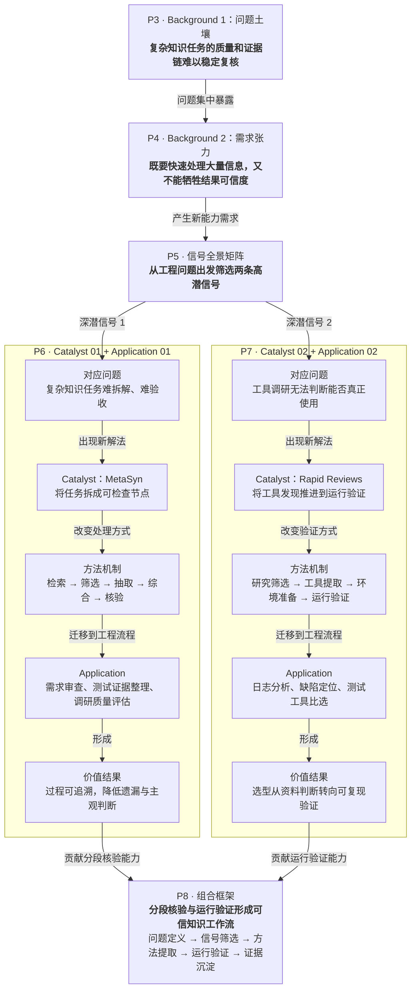

# 前沿雷达日报精读方法论模式

## 核心链路

外部信号 -> background -> Catalyst  -> Application  -> Trends  -> Action 

## 选信号规则

当原始信号 ≥ 3 条时，按以下维度选取 **2 条高价值信号** 进入深潜：

| 筛选维度  | 权重  | 说明                      |
| ----- | --- | ----------------------- |
| 得分    | 高   | 综合等分高                   |
| 影响面广度 | 高   | 影响多个业务线 / 技术栈层级         |
| 时效紧迫性 | 高   | 窗口期短，不跟进则错过             |
| 证据强度  | 中   | 有可量化的数据或标杆案例            |
| 组合价值  | 中   | 与其他信号形成协同效应，不能被夸大为平台级结论 |

## background / Catalyst / Application 规则

### 核心

逻辑关系必须通过业务内容、作用机制和图表关系表达，不得把“映射、承接、避免割裂”等设计语言直接写入主标题或副标题。

读者看完 P3—P7 后，必须能够回答：

1. 当前存在什么结构性问题；
2. 为什么这个问题现在必须解决；
3. 哪条技术信号改变了关键条件；
4. 该变化如何迁移到具体工程场景。

### 禁用规则

禁止让观众自己从图里“找逻辑”
禁止把“论文内容”直接当成“工程洞察”
禁止出现 background 列举问题 和 Catalyst / Application 描述的问题是同一类问题，但是文字描述不同

### 逻辑链正向示例

## 防退化规则

不得退化为：

- 论文摘要合集；
- 工具热度榜；
- 普通目录页；
- 空泛未来展望；
- 无来源评分表；
- 只给趋势不落行动；
- 所有application使用相同句式结构（机械模板化）。

## 复用级别

- 可长期复用：核心链路（§1）、选信号规则（§2）、Catalyst/Application 成对规则（§3）、防退化清单（§6）。
- 局部沉淀：趋势页四象限框架（§4）、行动收口要素（§5）。
- 一次性参考：具体信号名称、具体论文/工具/方法、具体日期和数据。

