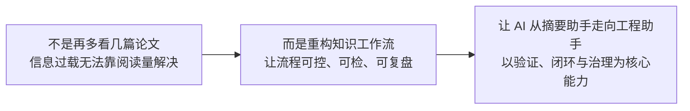
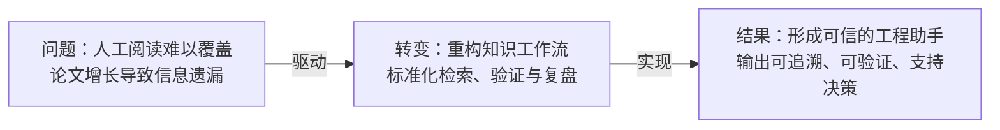

# 通用华为式文案规则

## 1. 总体风格

- 结论先行；
- 强判断；
- 少修饰；
- 多路径；
- 多抓手；
- 多闭环；
- 避免空泛口号。

## 2. 推荐词汇

抓手、牵引、底座、闭环、路径、机制、节奏、沉淀、复制、纳管、治理、运营、风险、边界、责任、里程碑、样板、标准化。

## 3. 禁止空话

不要写：

- 提升平台能力，赋能业务发展；
- 打造领先体系；
- 全面推进建设；
- 实现高质量发展；
- 构建完善生态。

应改成：

- 以统一机制为抓手，打通目标、资源、能力、运营四类关键链路。
- 当前核心矛盾不是单点能力不足，而是跨部门、跨系统、跨场景的闭环尚未打通。
- 建议采用“试点验证—能力沉淀—规模复制”的三阶段路径。

## 4. title 主标题规则

### 定位

主标题是页面可见的第一判断字段，必须帮助读者在进入图表前理解本页讨论对象、核心动作和预期结果。主标题不是章节标签、组件说明、版式说明或页面设计说明。

### 主标题规则

- 正文页主标题必须优先写成“对象 + 动作/机制 + 结果”的判断句。
- 冒号前可用于定锚行业、产品、平台、客户或场景；冒号后必须给出本页差异化判断。
- 标题动词必须能约束图表证明方向，优先使用可执行动词，如“构筑、打造、加速、使能、助力、引领、迈向、释放、沉淀、守护、推动、重塑”。
- 主标题、`core_judgement`、`chart_proof_goal` 必须围绕同一判断，但不得互相复读；标题负责可见判断，`core_judgement` 负责高层带走点，`chart_proof_goal` 负责主图证明关系。
- 章节页允许使用短标题，如“趋势洞察”“公司战略”；正文页不得用章节标签替代判断句。
- 专属术语只能在用户主题或参考材料明确命中时使用，不得把 `5.5G`、`F5.5G`、`Net5.5G`、`鲲鹏`、`昇腾`、`HarmonyOS`、`鸿蒙`、`光伏` 等主题词升级为全局默认表达。
- 主标题以一行判断为主；确需两行时，仍必须保留“对象 -> 机制 -> 结果”的逻辑骨架，避免堆叠口号。
- 标题回答“读者看完应带走什么”，不描述作者如何设计页面。
- 标题脱离上下文和口头讲解仍能独立理解。
- 结论优先，陈述句优先，把"不是...而是..." "不仅...而且...."改成直接陈述，并补充具体事实

### 正向标题结构

- 行业/对象定锚：`金融：基于云原生构建下一代数字核心系统，加速业务快速转型`
- 产品/平台定锚：`DataArts：数据治理生产线，一站式数智融合开发与治理`
- 技术路径判断：`从5G核心网走向5.5G智能核心网，持续使能新商业`
- 能力底座判断：`数据中心能源：构筑绿色可靠算力底座，让数字世界坚定运行`
- 客户价值判断：`联合伙伴，构筑“全生命周期”服务能力，加速行业智能化`

### 失败标题特征

- 只有名词标签，没有判断：`解决方案介绍`、`能力概览`、`项目背景`。
- 只有口号，没有对象和结果：`全面赋能未来`、`打造领先生态`。
- 冒号后仍是泛化名词：`金融：解决方案`、`DataArts：能力介绍`。
- 标题与主图不可互证：标题写“加速转型”，主图却只是同权卡片清单；标题写“构筑底座”，主图却没有支撑层级。
- 禁止将设计思路作为标题，如“建立对应关系”“形成映射结构”。
- 禁止将写作初衷作为标题，如“避免割裂感”“帮助读者理解”。
- 禁止使用“本页介绍、主要内容、总体框架”等页面说明。
- 禁止只有“背景分析、问题研究、迁移方法”等名词标签。
- 禁止使用“这组信号、当前情况、上述问题”等不明确指代。
- 禁止标题同时承载问题、方法、案例和结论。
- 禁止强行使用"不是...而是..." "不仅...而且...." 句式制造二元对立

### 长标题压缩规则

当标题超过 28~32 个汉字且包含多个从句时，应优先压缩成强判断句，避免标题变成摘要段落。

压缩后，副标题或讲解口径再承载背景说明。标题只承担一个判断，不同时承担背景、定义、路径和案例。

### 主标题正向案例清单

| # | 文件 | 主标题 |
|---:|---|---|
| 001 | IMG_8309.jpg | 华为是全球领先的ICT基础设施和智能终端提供商 |
| 002 | IMG_8310.jpg | 聚焦ICT技术，面向三类客户，携手生态及伙伴提供产品解决方案和服务 |
| 003 | IMG_8311.jpg | 2024年上半年公司整体经营稳健，结果符合预期 |
| 004 | IMG_8312.jpg | 保持强研发投入，以创新为客户和社会创造更多价值 |
| 005 | IMG_8313.jpg | 企业业务：携手客户和伙伴加速行业智能化，助力数智经济发展 |
| 006 | IMG_8314.jpg | 终端业务：加速生态化转型，全场景终端布局不断完善 |
| 007 | IMG_8315.jpg | 华为云业务：构筑核心技术生态，共建智能世界云底座 |
| 008 | IMG_8316.jpg | 数字能源业务：融合数字技术和电力电子技术，加速行业低碳转型 |
| 009 | IMG_8317.jpg | 智能汽车解决方案业务：携手伙伴，引领汽车产业智能化发展 |
| 011 | IMG_8319.jpg | 智能世界是人类发展的必由之路，带来更美好的生活，更和谐的社会 |
| 012 | IMG_8320.jpg | 发电低碳化和数字化使能绿色低碳发展 |
| 013 | IMG_8321.jpg | 各国积极行动，陆续发布相关战略，聚焦提升智能化及绿色竞争力 |
| 014 | IMG_8322.jpg | 趋势洞察（章节页，高亮：产业趋势） |
| 015 | IMG_8323.jpg | 运力、算力、存力，筑牢数智经济基石 |
| 016 | IMG_8324.jpg | 5G进入发展快车道，5.5G开启商用元年 |
| 017 | IMG_8325.jpg | 从联接到业务使能，5.5G核心网持续释放移动网络的商业价值 |
| 018 | IMG_8326.jpg | 非结构化数据爆发式增长，AI加速数据资产化，存力正经历五大变化 |
| 019 | IMG_8327.jpg | 人工智能走进企业核心生产系统，行业加速向智能化升级 |
| 020 | IMG_8328.jpg | 公共事业：政府与公共事业加速智能化，共建“数智社会” |
| 021 | IMG_8329.jpg | 金融：智能化加速业务决策，服务迈向无处不在 |
| 022 | IMG_8330.jpg | 电力：数智赋能新型电力系统，数能融合促进能源高质量发展 |
| 023 | IMG_8331.jpg | 制造与大企业：数实融合走深向实，智能化将成就百业齐放 |
| 024 | IMG_8332.jpg | 矿山：数智技术赋能安全生产，智能矿山建设成为必由之路 |
| 025 | IMG_8333.jpg | 油气：勘探研究与生产作业向智能化演进，助力油气增储上产及高效运营 |
| 026 | IMG_8334.jpg | ISP：ICT基础设施向万兆化、服务化、智能化发展 |
| 027 | IMG_8335.jpg | 公司战略（章节页，高亮：为客户创造价值） |
| 028 | IMG_8336.jpg | 网-云-智协同，“三大创新”引领智能世界新机遇 |
| 029 | IMG_8337.jpg | 业务创新：创新应用开启用户体验新纪元，驱动5.5G演进 |
| 030 | IMG_8338.jpg | 体验创新：DigiVerse 3.0全栈协同，加速数字化到数智化转型 |
| 031 | IMG_8339.jpg | 体验创新：通信大模型助力运营商释放网络与业务潜能 |
| 032 | IMG_8340.jpg | 携手伙伴，深耕行业，加速行业智能化 |
| 033 | IMG_8341.jpg | 以客户为中心，持续推出有竞争力的产品/产品组合和场景化解决方案 |
| 034 | IMG_8342.jpg | 以客户为中心，持续推出有竞争力的产品/产品组合和场景化解决方案 |
| 035 | IMG_8343.jpg | 政务：AI赋能政务服务，实现“能办、可办”向“好办、智办”升级 |
| 036 | IMG_8344.jpg | 政务：政府骨干网，助力乌干达实现数字化愿景 |
| 037 | IMG_8345.jpg | 教育：智慧教室实现创新教学，加速教学全流程智能化 |
| 038 | IMG_8346.jpg | 医疗：打造智慧医院新标杆，全面提升诊疗效率和就医体验 |
| 039 | IMG_8347.jpg | 金融：基于云原生构建下一代数字核心系统，加速业务快速转型 |
| 040 | IMG_8348.jpg | 航空：构建有世界影响力，国内领先的机场集团 |
| 041 | IMG_8349.jpg | 城轨：城轨云解决方案助力企业数字化转型升级 |
| 042 | IMG_8350.jpg | 城轨：LTE-M构建极简安全可靠的城轨通信专网 |
| 043 | IMG_8351.jpg | 城市交通：数智赋能，打造城市综合交通管控服务新范式 |
| 044 | IMG_8352.jpg | 港口：多级运管平台提升管控与协同发展能力，迈向港产城融合发展 |
| 045 | IMG_8353.jpg | 口岸：智慧卡口助力口岸通关效率提升 |
| 046 | IMG_8354.jpg | 电力：打造工业级数字底座，助力陕西建设现代智慧配电物联网 |
| 047 | IMG_8355.jpg | 制造：以数字底座沉淀能力打造智慧工厂 |
| 048 | IMG_8356.jpg | 矿业：盘古矿山大模型助力矿山客户实现AI应用“工业化”开发 |
| 049 | IMG_8357.jpg | ISP：连接万兆化助力客户业务创新，价值变现 |
| 050 | IMG_8358.jpg | 伙伴：持续发展伙伴，助力行业客户智能化转型 |
| 051 | IMG_8359.jpg | 泛政企客户：携手伙伴，加速中小企业数字化与智能化 |
| 052 | IMG_8360.jpg | 小微企业：以分销商为主，以工程商为中心，构建健康的分销伙伴体系 |
| 053 | IMG_8361.jpg | 小微企业：以分销商为主，以工程商为中心，构建健康的分销伙伴体系 |
| 054 | IMG_8362.jpg | 联合伙伴，构筑“全生命周期”服务能力，加速行业智能化 |
| 055 | IMG_8363.jpg | HarmonyOS持续迭代演进，智慧安全，常用常新 |
| 056 | IMG_8364.jpg | 鸿蒙原生应用全面启动，为开发者提供从底座到工具全栈方案 |
| 057 | IMG_8365.jpg | 鸿蒙硬件产品迅速发展，引领智能化体验落地 |
| 058 | IMG_8366.jpg | 全面赋能鸿蒙生态开发者、助力伙伴、开展人才培养 |
| 059 | IMG_8367.jpg | 持续建设高端零售门店，打造消费者服务体验的标杆 |
| 060 | IMG_8368.jpg | 以消费者为中心，聚焦精品，打造智慧生活体验 |
| 061 | IMG_8369.jpg | 公司战略（章节页，高亮：引领产业发展） |
| 062 | IMG_8370.jpg | 拥抱智能时代，打造领先的ICT数智基础设施 |
| 063 | IMG_8371.jpg | 持续领先，持续引领产业，持续支撑客户商业成功 |
| 064 | IMG_8372.jpg | 无线迈向5.5G商用时代，满足多元化业务体验升级及行业数智化转型 |
| 065 | IMG_8373.jpg | TDD走向更多频段、更多通道ELAA，构筑万兆极致体验 |
| 066 | IMG_8374.jpg | DIS性能节能双升级，室内走向全场景数字化 |
| 067 | IMG_8375.jpg | 全系列绿色天线，构筑能效和性能新标杆 |
| 068 | IMG_8376.jpg | IntelligentRAN，迈向L4高阶自智网络 |
| 069 | IMG_8377.jpg | 光产业市场与技术长期领先，引领产业繁荣发展 |
| 070 | IMG_8378.jpg | F5.5G全光目标网，加速万兆超宽带发展 |
| 071 | IMG_8379.jpg | 全光联接加速数字化建网，打造超千兆极致体验 |
| 072 | IMG_8380.jpg | F5G全光承载：坚如磐石的行业光通信网，助力电力交通数智化 |
| 073 | IMG_8381.jpg | Net5.5G构建智能时代高品质超宽智能运力网络，获得业界广泛认可 |
| 074 | IMG_8382.jpg | 超融合数据中心网络：构建AI数据中心高运力网络，多元算力智能管理 |
| 075 | IMG_8383.jpg | 广域网络：Net5.5G融合承载网络，助力运营商全业务增长 |
| 076 | IMG_8384.jpg | 高品质万兆园区：以体验为中心，打造高品质万兆园区 |
| 077 | IMG_8385.jpg | 网络数字地图：数据 + 知识协同，筑基网络智能化平台 |
| 078 | IMG_8386.jpg | 从5G核心网走向5.5G智能核心网，持续使能新商业 |
| 079 | IMG_8387.jpg | 智能分组核心网，通过网络智能和增强用户面实现体验经营和泛在万兆 |
| 080 | IMG_8388.jpg | 自智网络产业稳步推进，华为积极推动产业繁荣 |
| 081 | IMG_8389.jpg | ADN构筑通信大模型底座，使能四大商业价值 |
| 082 | IMG_8390.jpg | ADN使能MBB高稳质优，绿色节能 |
| 083 | IMG_8391.jpg | ADN使能FBB网络自治，提质增效 |
| 084 | IMG_8392.jpg | 围绕鲲鹏和昇腾，共建多样性计算新生态 |
| 085 | IMG_8393.jpg | openEuler面向多样性计算，支持数字基础设施全场景 |
| 086 | IMG_8394.jpg | 昇腾AI，使能百模千态、赋能千行万业 |
| 087 | IMG_8395.jpg | 持续研发投入，实力获得业界广泛认可 |
| 088 | IMG_8396.jpg | 构建先进数据存力，释放数据价值 |
| 089 | IMG_8397.jpg | OceanStor A800：全球领先的AI知识库存储加速大模型训练/推理 |
| 090 | IMG_8398.jpg | OceanDisk智能盘框：面向云/互联网/HPC场景的最佳存储底座 |
| 091 | IMG_8399.jpg | 业界首创6层防勒索解决方案，构筑数据安全最后一道防线 |
| 092 | IMG_8400.jpg | 智能协作：从会议到办公到生产，以实时音视频通信助力构建智能世界 |
| 093 | IMG_8401.jpg | 业界首款双模引擎，打造融合、智能的协同办公新体验 |
| 094 | IMG_8402.jpg | 新一代旗舰IdeaHub ES2 Plus，鸿蒙智慧办公，高层会议首选 |
| 095 | IMG_8403.jpg | 产品组合方案：助力客户建设先进的数字基础设施 |
| 096 | IMG_8404.jpg | 园区：创新ICT基础设施，使能伙伴，持续助力园区数字化转型 |
| 097 | IMG_8405.jpg | 数字站点：助力外场基础设施数智化 |
| 098 | IMG_8406.jpg | 广域网络：构筑广域目标网，释放数据与算力的潜能 |
| 099 | IMG_8407.jpg | 持续领先，成为最可信赖的服务伙伴，共建极致体验的智能世界 |
| 100 | IMG_8408.jpg | 智稳网络：为网络稳健运行护航，行稳致远 |
| 101 | IMG_8409.jpg | 智能运维：+AI，引领智能运维转型 |
| 102 | IMG_8410.jpg | 智优体验：打造领先网络性能与极致业务体验，激发数据新价值 |
| 103 | IMG_8411.jpg | 智赋人才：链接全球智慧，培养智能时代新型数智人才 |
| 104 | IMG_8412.jpg | 围绕消费者核心需求，打造引领未来的极优体验 |
| 105 | IMG_8413.jpg | ID/形态：打造极致、简约、纯净的设计风格，引领折叠形态创新 |
| 106 | IMG_8414.jpg | 影像：围绕光机电算持续创新，成为消费者心目中的影像王者 |
| 107 | IMG_8415.jpg | 材料/可靠：特殊材质与制造工艺，耐摔、抗冲击、抗水独步领先 |
| 108 | IMG_8416.jpg | 华为云：AI Ready，加速千行万业智能升级 |
| 109 | IMG_8417.jpg | 最专注行业：解难题，做难事，助力20+行业、1000+客户商业成功 |
| 110 | IMG_8418.jpg | 秉承开放与安全，守护客户核心关切，帮助客户炼好自己的大模型 |
| 111 | IMG_8419.jpg | DataArts：数据治理生产线，一站式数智融合开发与治理 |
| 112 | IMG_8420.jpg | CodeArts：智能化软件开发生产线，加速企业应用现代化 |
| 113 | IMG_8421.jpg | CraftArts：硬件开发生产线，重塑工业软件协同模式和开发体验 |
| 114 | IMG_8422.jpg | 分布式QingTian：系统性架构升级，打破单服务器硬件限制 |
| 115 | IMG_8423.jpg | 昇腾AI云服务，澎湃算力支持大模型普惠 |
| 116 | IMG_8424.jpg | 融合数字技术和电力电子技术，发展清洁能源与能源数字化，推动能源革命，共建绿色美好未来 |
| 117 | IMG_8425.jpg | 智能光伏：加速光伏成为主力能源，让绿色电力惠及千行百业、千家万户 |
| 118 | IMG_8426.jpg | 数据中心能源：构筑绿色可靠算力底座，让数字世界坚定运行 |
| 119 | IMG_8427.jpg | 智能车载光：开创智能汽车新视界 |
| 120 | IMG_8428.jpg | 公司战略（章节页，高亮：研究与创新） |
| 121 | IMG_8429.jpg | 强力投入研究与开发，以创新驱动未来发展 |
| 122 | IMG_8430.jpg | 全球高校开展广泛的技术合作，促进技术不断创新 |
| 123 | IMG_8431.jpg | 开放、合作、共赢，加速生态发展，推动产业繁荣 |
| 124 | IMG_8432.jpg | 粘结世界智慧，培育青年才俊，攻克产业难题，共建学术社区 |
| 125 | IMG_8433.jpg | 积极推动ICT基础设施、智能终端、智能驾驶等软硬件的标准与生态 |
| 126 | IMG_8434.jpg | 开源的坚定支持者和重要贡献者 |
| 127 | IMG_8435.jpg | 激发生态创新，加大技术赋能，助力生态价值创造 |
| 128 | IMG_8436.jpg | 沉淀优秀经验，以能力为核心发展伙伴，让开发者成为决定性力量 |
| 129 | IMG_8437.jpg | 高质量意味着低成本，以质取胜是华为坚定不移的核心战略选择 |
| 130 | IMG_8438.jpg | 深耕数字化，“平台+服务”实现多业态下业务能力共享，在追求客户满意的同时，追求效率效益提升 |
| 131 | IMG_8439.jpg | 华为聚焦可持续发展四大战略，创造社会价值 |
| 132 | IMG_8440.jpg | 行胜于言，携手构建可持续发展的美好未来 |
| 133 | IMG_8441.jpg | TECH4ALL：华为面向数字包容领域的倡议和长期行动计划 |
| 134 | IMG_8442.jpg | 公平优质教育：Open Schools提升多国基础教育学习韧性和连续性 |
| 135 | IMG_8443.jpg | 公平优质教育：科技小学堂激发中国乡村学生好奇心及提升科技素养 |
| 136 | IMG_8444.jpg | 保护脆弱环境：促进生物多样性保护，助力自然资源可持续管理 |
| 137 | IMG_8445.jpg | 保护脆弱环境：守护鸟中国宝--东方白鹳 |
| 138 | IMG_8446.jpg | 促进健康福祉：“鹤颜课堂”让老年群体更好享受数字生活 |
| 139 | IMG_8447.jpg | 网络安全与隐私保护是华为公司的最高纲领 |
| 140 | IMG_8448.jpg | 华为端到端网络安全保障体系覆盖了所有的部门和人员 |
| 141 | IMG_8449.jpg | 尊重和保护隐私，依法合规，满足客户、消费者和雇员的隐私期望 |
| 142 | IMG_8450.jpg | 践行节能减排的创新和实践，加速行业低碳化转型 |
| 143 | IMG_8451.jpg | 持续加大可再生能源使用，以创新技术推动能源革命 |
| 144 | IMG_8452.jpg | 供应责任：实施全供应链尽责管理，持续提升供应链韧性 |
| 145 | IMG_8453.jpg | 未来种子：为万物互联的智能世界培养数字人才 |
| 146 | IMG_8454.jpg | 华为ICT学院：联接全球2700+所高校，为社会培养ICT人才 |

## 副标题 规则

### 核心要点

主标题负责下结论，副标题负责限定和解释。

### 执行规则

副标题内容必须能被主体区信息直接支撑。

### 禁用规则

禁止描述文案初衷，如“避免割裂感”“便于读者理解”。
禁止描述页面结构，如“建立对应关系”“从三个维度展开”。
禁止简单复述或改写主标题。
禁止提出与主标题并列的第二个核心结论。
禁止堆叠背景、方法、案例和行动建议。
禁止使用指代不明或依赖口头讲解的表述。
禁止使用过长句子，将副标题写成摘要段落。

## 5. 主体区

### 反向案例

**反例原因：**
- 标题指代不清，无法独立理解。
- 问题、方法、目标混合并列。
- 箭头暗示流程，但缺少完整因果机制。
- 抽象术语较多，没有落到具体价值。

### 正向案例

---

## 7. 解决方案型表达沉淀

### 7.1 标题句式

- **趋势加速型**：`从{旧状态/单点能力}走向{新状态/体系化能力}`
- **能力牵引型**：`以{关键场景}牵引{平台/机制/能力}持续演进`
- **价值闭环型**：`围绕{目标对象}打通{能力—场景—运营—价值}闭环`
- **生态协同型**：`以{中心平台/核心能力}连接{伙伴/场景/行业}，形成可复制解决方案`
- **证明收口型**：`通过{样板/案例/指标}验证路径，再推动规模化复制`

### 7.2 页面收口规则

- 场景页收口：从“场景价值”落到“可复制能力”，避免只讲案例热闹。
- 能力页收口：从“能力清单”落到“建设抓手/运营机制”。
- 生态页收口：从“伙伴数量/覆盖范围”落到“协同关系和价值流”。
- 成果页收口：从“大数字”落到“下一步如何沉淀和复制”。

### 7.3 禁止泛化

- 不得把“赋能、打造、领先、全面升级”等词单独作为结论；必须补齐对象、抓手和动作。
- 不得无来源生成具体增长、覆盖、排名、案例数量等事实型表达。

---

## 8. 强判断标题的支撑规则

强判断标题必须配强支撑，避免“标题很硬、正文很散”。

### 8.1 “不是 A，而是 B”标题

正文必须按以下链路展开：

1. 现状：当前普遍做法或表象是什么；
2. 误区：为什么 A 不是核心；
3. 风险：继续停留在 A 会带来什么问题；
4. 行动：B 应如何建设或治理。

### 8.2 “倒逼 / 重构 / 转向”标题

正文必须说明：

- 驱动力是什么；
- 被改变的对象是什么；
- 重构后的目标态是什么；
- 需要什么治理动作。

### 8.3 “无法支撑 / 不可信 / 风险放大”标题

正文必须补齐证据链或机制链，至少回答：

- 缺什么；
- 为什么导致不可信；
- 影响哪个流程或决策；
- 应该用什么机制补齐。

## 9. 抽象概念定义规则

抽象概念首次出现时，必须给出一句可执行定义，避免口号化。

推荐句式：

- `{概念} = {对象} + {能力} + {治理边界}`；
- `{概念} 不是 {误区}，而是 {可执行目标}`；
- `{概念} 的最小闭环是 {输入}—{处理}—{审查}—{沉淀}`。

示例：

- `AI-ready 工程模型 = 可被 AI 读取、验证、追溯并受控参与的工程模型体系`；
- `可信工程底座 = 来源、推导、状态、责任、审查可追溯的工程记录`；
- `贡献治理 = AI 内容先候选、再审查、后提交、可回溯`。

## 10. 总结页最终定义规则

总结页不应复述前文要点，而应形成最终定义或决策框架。

推荐句式：

- `X = 对象 + 能力 + 治理边界`
- `X 的本质不是 A，而是 B`
- `最终要形成 A、B、C、D 四类可验收能力`

如果总结页只罗列关键词，必须补一句“因此高层应如何判断/拍板/验收”的管理含义。

## 防骨架填词规则

禁止把固定句式作为字段生成器直接套用：

- 不得把 `core_judgement` 写成固定前缀 + `conclusion`；
- 不得把 `chart_proof_goal` 写成固定前缀 + 关键词拼接 + 固定后缀；
- 不得让 page_copy 的“核心判断”原样复制“一句话结论”；
- 不得让所有页面使用同一句讲解口径。

允许统一表达风格，也允许背景页对结论进行正当提炼，但每页必须形成独立带走点或图表证明关系。

## 底部结论条 文案表达规则

### 核心内容
 底部结论条必须给出本页的最终判断：基于页面信息，观众应该记住什么结论、采取什么动作或接受什么决策。

### 执行规则
- 承接页面证据：结论必须来自本页图表、数据、流程、对比或案例，不能脱离页面内容另起一句口号。
- 压缩为一个判断：只保留一个主结论
- 结论优先，陈述句优先，把"不是...而是..." "不仅...而且...."改成直接陈述，并补充具体事实

### 禁用规则
- 禁止复述主标题和副标题：底部结论条不能只是把标题、副标题、模块名换一种说法。
- 禁止空泛正确话，不写“提升效率、形成闭环、强化协同、持续优化、赋能业务、夯实基础”等无法验证的通用表达。
- 禁止堆多个观点，不在同一条结论里并列三四个方向，避免变成摘要、清单或口号合集。
- 禁止重复描述在本页做了什么
- 禁止强行使用"不是...而是..." "不仅...而且...." 句式制造二元对立